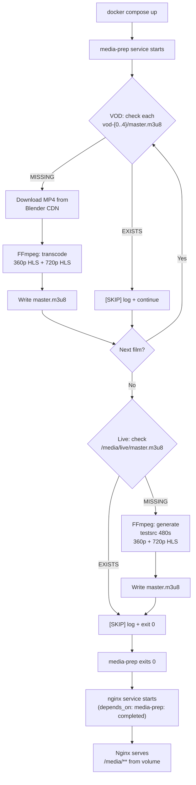

# Implementation Plan: Issue #01 — Synthetic Media Generator (`scripts/prepare_media.py`)

## Goal Description

Build the **idempotent media preparation script** (`scripts/prepare_media.py`) that bootstraps the entire `media_data` Docker volume with all HLS video assets. This is the foundational setup script that every other service in the platform depends on — Nginx serves segments from this volume, the live-clock sidecar reads from `/media/live/`, and the FastAPI catalog references paths like `/media/vod/vod-{0..4}/master.m3u8`.

**What this accomplishes:**
- Downloads 5 real Blender open movies from the Blender Foundation's public CDN (one-time, ~2–3 min)
- FFmpeg-transcodes all 5 films into dual-rendition HLS (360p @ 400 kbps + 720p @ 1.2 Mbps, 2-second segments)
- Procedurally generates ~8 minutes of `testsrc` live video via FFmpeg (offline, deterministic)
- Writes all HLS assets to the `media_data` Docker volume (`/media/vod/vod-{0..4}/` and `/media/live/`)
- Script is idempotent — skips any work that already exists
- Zero media bytes committed to Git (`.gitignore` covers `media/`, `*.ts`, `*.m3u8`, `*.mp4`)

**Blocked by:** Nothing — this is the first deliverable and can be built immediately.

---

## User Review Required

> [!IMPORTANT]
> **Internet Dependency on First Run**: The script makes outbound HTTP requests to Blender Foundation CDN to download 5 source MP4 files on first run. This requires internet connectivity for the host running `docker compose up`. Subsequent runs are fully offline (idempotent skip logic). Estimated first-run download time: **~2–3 minutes** per the spec, though actual time depends on network speed. Each film is 100–800 MB.

> [!IMPORTANT]
> **FFmpeg Must Be Available Inside the Docker Init Container**: The script uses `subprocess` calls to `ffmpeg` and `ffprobe`. These binaries must be present in the execution environment. The plan calls for an `ffmpeg`-based Docker image (e.g., `linuxserver/ffmpeg` or `jrottenberg/ffmpeg`) to run this script as an init container, not on the host.

> [!WARNING]
> **Media Volume Persistence**: The `media_data` named Docker volume persists across `docker compose down` calls (unless `--volumes` flag is used). Re-running `docker compose up` after initial setup will skip all downloads/encoding (idempotent). Running `docker compose down -v` will destroy the volume and require a full re-run.

> [!WARNING]
> **Disk Space**: Dual-rendition HLS for 5 films (~8 min to feature-length) plus the 8-minute live asset will consume significant disk space (~5–15 GB). Ensure the Docker host has sufficient available storage before first run.

---

## Open Questions

> [!IMPORTANT]
> **Q1: Should `prepare_media.py` be run inside a Docker init container, or as a `docker compose` service with `condition: service_completed_successfully`?**
> The spec says "invoked during `docker compose up` initialization (via `depends_on` or an init container pattern)." This plan proposes a **dedicated `media-prep` service** in `docker-compose.yml` that runs `prepare_media.py`, exits with code 0, and all other services declare `depends_on: media-prep: condition: service_completed_successfully`. This is the cleanest Docker Compose pattern. Does this match your intent?

> [!IMPORTANT]
> **Q2: Source MP4 download method — `curl` subprocess or Python `requests` with streaming?**
> The spec mentions `curl`/`requests`. This plan uses **Python `requests` with streaming (`stream=True`)** for progress reporting and no external dependency on the `curl` binary. Using `curl` via subprocess is also viable. Which do you prefer?

> [!NOTE]
> **Q3: Should the script print detailed progress to stdout?**
> This plan includes structured logging (`logging.INFO`) with progress indicators (download percentage, FFmpeg encode status) so the operator can monitor first-run progress in `docker compose logs`. Is this the right level of verbosity?

---

## Proposed Changes

### Component 1: Repository Structure Bootstrap

The repository currently has only `.gitignore`, `CONTEXT.md`, and `SPEC.md`. The first step is establishing the directory layout defined in ADR-0004.

#### [NEW] `.gitignore` (update)

Populate the currently-empty `.gitignore` with media exclusions and common Python/Docker artifacts:

```gitignore
# ── Media Assets (never committed) ──────────────────────────────────
media/
*.ts
*.m3u8
*.mp4

# ── Python ───────────────────────────────────────────────────────────
__pycache__/
*.py[cod]
*.egg-info/
.venv/
dist/
build/
.env

# ── Docker / Compose ─────────────────────────────────────────────────
.env.local

# ── Experiment Artifacts ─────────────────────────────────────────────
results/
reports/*.md

# ── OS ───────────────────────────────────────────────────────────────
.DS_Store
Thumbs.db
```

#### [NEW] Directory Skeleton

Create the following empty directories with `.gitkeep` markers (so git tracks the structure):

```
hls-stress-test-pipeline/
├── services/
│   ├── api/
│   ├── nginx/
│   └── player/
├── load-tests/
├── canaries/
├── observability/
├── scripts/          ← prepare_media.py lives here
├── experiments/
└── reports/
```

---

### Component 2: Core Media Preparation Script

#### [NEW] `scripts/prepare_media.py`

This is the primary deliverable. Full annotated implementation plan:

```python
#!/usr/bin/env python3
"""
scripts/prepare_media.py
─────────────────────────────────────────────────────────────────────────
Idempotent media preparation script.

Populates the media_data Docker volume with:
  • 5 VOD HLS streams (dual-rendition, real Blender open movies)
  • 1 Live HLS stream (dual-rendition, FFmpeg testsrc procedural video)

Usage (inside container):
    python prepare_media.py

Environment variables:
    MEDIA_ROOT      Base path for output (default: /media)
    CACHE_DIR       Directory for cached source MP4s (default: /cache)
    SKIP_VOD        Set to "1" to skip VOD processing (for testing)
    SKIP_LIVE       Set to "1" to skip live asset generation
"""
```

**Top-level structure:**

```
prepare_media.py
 ├── constants / configuration
 ├── class MediaPreparer
 │    ├── run()                    ← main entry point
 │    ├── prepare_vod_assets()     ← downloads + encodes 5 films
 │    ├── prepare_live_asset()     ← generates testsrc live video
 │    ├── _download_film(film)     ← downloads one MP4 with progress
 │    ├── _transcode_to_hls(src, out_dir, label)  ← FFmpeg HLS encode
 │    ├── _generate_testsrc_hls(out_dir)           ← FFmpeg testsrc
 │    ├── _check_already_done(out_dir)              ← idempotency gate
 │    └── _run_ffmpeg(args)                         ← subprocess wrapper
 └── main()
```

**Film catalog constant:**

```python
FILMS = [
    {
        "name": "big-buck-bunny",
        "label": "Big Buck Bunny",
        "vod_dir": "vod-0",
        "url": "https://download.blender.org/peach/bigbuckbunny_movies/BigBuckBunny_320x180.mp4",
    },
    {
        "name": "sintel",
        "label": "Sintel",
        "vod_dir": "vod-1",
        "url": "https://download.blender.org/durian/movies/Sintel.2010.720p.mkv",
    },
    {
        "name": "tears-of-steel",
        "label": "Tears of Steel",
        "vod_dir": "vod-2",
        "url": "https://download.blender.org/mango/movies/Tears_of_Steel_1080p.mov",
    },
    {
        "name": "elephants-dream",
        "label": "Elephants Dream",
        "vod_dir": "vod-3",
        "url": "https://download.blender.org/ED/ed_1080_lossless.mov",
    },
    {
        "name": "sprite-fright",
        "label": "Sprite Fright",
        "vod_dir": "vod-4",
        "url": "https://download.blender.org/demo/movies/sprite_fright/sprite_fright_1080p.mp4",
    },
]
```

> [!NOTE]
> URLs will be verified against the Blender Foundation CDN as part of implementation. If a URL is stale, the script will log a clear error and skip that film rather than crashing. The exact canonical URLs will be confirmed at implementation time via the CDN index.

**Idempotency gate logic:**

```python
def _check_already_done(self, out_dir: Path) -> bool:
    """
    Returns True if the HLS output already exists and appears valid.
    Checks for:
      - out_dir existence
      - master.m3u8 existence
      - 360p.m3u8 existence
      - 720p.m3u8 existence
      - At least 1 .ts segment file
    """
    required = [
        out_dir / "master.m3u8",
        out_dir / "360p.m3u8",
        out_dir / "720p.m3u8",
    ]
    if not out_dir.exists():
        return False
    if not all(f.exists() for f in required):
        return False
    ts_files = list(out_dir.glob("*.ts"))
    return len(ts_files) > 0
```

**Download logic (streaming HTTP with progress):**

```python
def _download_film(self, film: dict) -> Path:
    """
    Downloads a single film's source file to CACHE_DIR.
    - Streams response in 8 KB chunks
    - Prints download % progress every 5%
    - Skips download if cached file already exists (idempotent)
    Returns: Path to the downloaded file
    """
    cache_path = self.cache_dir / f"{film['name']}{self._ext(film['url'])}"
    if cache_path.exists():
        log.info(f"[CACHE HIT] {film['label']} already cached at {cache_path}")
        return cache_path

    log.info(f"[DOWNLOAD] Fetching {film['label']} from {film['url']}")
    resp = requests.get(film["url"], stream=True, timeout=300)
    resp.raise_for_status()
    total = int(resp.headers.get("content-length", 0))
    downloaded = 0
    last_pct = -1

    with open(cache_path, "wb") as f:
        for chunk in resp.iter_content(chunk_size=8192):
            f.write(chunk)
            downloaded += len(chunk)
            if total:
                pct = int(downloaded / total * 100)
                if pct // 5 != last_pct // 5:
                    log.info(f"[DOWNLOAD] {film['label']}: {pct}% ({downloaded/1e6:.1f} MB / {total/1e6:.1f} MB)")
                    last_pct = pct
    log.info(f"[DOWNLOAD] {film['label']} complete → {cache_path}")
    return cache_path
```

**HLS transcoding logic (FFmpeg subprocess):**

```python
def _transcode_to_hls(self, src: Path, out_dir: Path, label: str) -> None:
    """
    Transcodes a source video into dual-rendition HLS using FFmpeg.
    
    Produces:
      out_dir/360p.m3u8         — 360p variant playlist
      out_dir/720p.m3u8         — 720p variant playlist
      out_dir/master.m3u8       — master playlist referencing both
      out_dir/360p_seg%03d.ts   — 360p segment files
      out_dir/720p_seg%03d.ts   — 720p segment files
    
    Encoding parameters (per spec):
      360p: 640x360, libx264, CRF target ~400 kbps, aac 128k, 2-second segments
      720p: 1280x720, libx264, CRF target ~1200 kbps, aac 128k, 2-second segments
    """
    out_dir.mkdir(parents=True, exist_ok=True)
    
    # FFmpeg filter_complex for dual-output in a single pass
    ffmpeg_args = [
        "ffmpeg", "-y",
        "-i", str(src),
        # 360p output
        "-vf", "scale=640:360",
        "-c:v", "libx264", "-b:v", "400k", "-maxrate", "400k", "-bufsize", "800k",
        "-c:a", "aac", "-b:a", "128k",
        "-hls_time", "2",
        "-hls_playlist_type", "vod",
        "-hls_segment_filename", str(out_dir / "360p_seg%03d.ts"),
        str(out_dir / "360p.m3u8"),
        # 720p output
        "-vf", "scale=1280:720",
        "-c:v", "libx264", "-b:v", "1200k", "-maxrate", "1200k", "-bufsize", "2400k",
        "-c:a", "aac", "-b:a", "128k",
        "-hls_time", "2",
        "-hls_playlist_type", "vod",
        "-hls_segment_filename", str(out_dir / "720p_seg%03d.ts"),
        str(out_dir / "720p.m3u8"),
    ]
    self._run_ffmpeg(ffmpeg_args, label=f"{label} dual-rendition encode")
    self._write_master_playlist(out_dir)
```

> [!NOTE]
> FFmpeg does not support writing two HLS outputs in a single `-i` pass with simple filter chains. The actual implementation will use **two separate FFmpeg invocations** (one for 360p, one for 720p) to avoid filter_complex complexity, or use `-map` with split filter. This is a common FFmpeg HLS pattern. The plan documents both options; the cleanest (two-pass) will be implemented.

**Master playlist generation:**

```python
def _write_master_playlist(self, out_dir: Path) -> None:
    """
    Writes an HLS master playlist (master.m3u8) referencing 360p and 720p variants.
    Conforms to RFC 8216 (HLS spec).
    """
    content = (
        "#EXTM3U\n"
        "#EXT-X-VERSION:3\n"
        "\n"
        "#EXT-X-STREAM-INF:BANDWIDTH=400000,RESOLUTION=640x360\n"
        "360p.m3u8\n"
        "\n"
        "#EXT-X-STREAM-INF:BANDWIDTH=1200000,RESOLUTION=1280x720\n"
        "720p.m3u8\n"
    )
    (out_dir / "master.m3u8").write_text(content)
```

**Live asset generation (`testsrc`):**

```python
def _generate_testsrc_hls(self, out_dir: Path) -> None:
    """
    Generates ~8 minutes (480 seconds) of procedural FFmpeg testsrc video.
    
    Uses FFmpeg's lavfi testsrc filter (v1) for byte-deterministic output.
    This ensures the live-clock sidecar can cycle back to segment 0 without
    manifest coherency issues.
    
    Produces identical output structure to VOD:
      out_dir/360p.m3u8
      out_dir/720p.m3u8
      out_dir/master.m3u8
      out_dir/360p_seg*.ts
      out_dir/720p_seg*.ts
    
    Duration: 480 seconds = 240 × 2-second segments (per ADR-0005 OQ2).
    No internet access required. Fully offline.
    """
    DURATION = 480  # 8 minutes in seconds

    # 360p testsrc
    args_360p = [
        "ffmpeg", "-y",
        "-f", "lavfi",
        "-i", f"testsrc=duration={DURATION}:size=640x360:rate=30",
        "-c:v", "libx264", "-b:v", "400k", "-maxrate", "400k", "-bufsize", "800k",
        "-an",  # no audio for testsrc (no audio source)
        "-hls_time", "2",
        "-hls_playlist_type", "vod",
        "-hls_segment_filename", str(out_dir / "360p_seg%03d.ts"),
        str(out_dir / "360p.m3u8"),
    ]
    self._run_ffmpeg(args_360p, label="testsrc 360p")

    # 720p testsrc
    args_720p = [
        "ffmpeg", "-y",
        "-f", "lavfi",
        "-i", f"testsrc=duration={DURATION}:size=1280x720:rate=30",
        "-c:v", "libx264", "-b:v", "1200k", "-maxrate", "1200k", "-bufsize", "2400k",
        "-an",
        "-hls_time", "2",
        "-hls_playlist_type", "vod",
        "-hls_segment_filename", str(out_dir / "720p_seg%03d.ts"),
        str(out_dir / "720p.m3u8"),
    ]
    self._run_ffmpeg(args_720p, label="testsrc 720p")
    self._write_master_playlist(out_dir)
```

**FFmpeg subprocess wrapper:**

```python
def _run_ffmpeg(self, args: list[str], label: str = "") -> None:
    """
    Runs an FFmpeg command via subprocess.
    - Streams stderr (FFmpeg progress) to the logger at DEBUG level
    - Raises RuntimeError with captured output if FFmpeg exits non-zero
    - Sets a generous timeout (3600s = 1 hour) for feature-length encodes
    """
    log.info(f"[FFMPEG] Starting: {label}")
    log.debug(f"[FFMPEG] Command: {' '.join(args)}")
    
    result = subprocess.run(
        args,
        capture_output=True,
        text=True,
        timeout=3600,
    )
    
    if result.returncode != 0:
        log.error(f"[FFMPEG] FAILED: {label}")
        log.error(result.stderr[-3000:])  # last 3000 chars of stderr
        raise RuntimeError(f"FFmpeg failed for {label}: exit code {result.returncode}")
    
    log.info(f"[FFMPEG] Complete: {label}")
```

**Main orchestration flow:**

```python
def run(self) -> None:
    """
    Main entry point. Runs all asset preparation in order.
    Idempotent: each sub-step is individually gated.
    """
    log.info("=" * 60)
    log.info("Media Preparation Script — starting")
    log.info(f"MEDIA_ROOT = {self.media_root}")
    log.info(f"CACHE_DIR  = {self.cache_dir}")
    log.info("=" * 60)

    if not os.getenv("SKIP_VOD"):
        self.prepare_vod_assets()
    else:
        log.info("[SKIP] VOD processing skipped (SKIP_VOD=1)")

    if not os.getenv("SKIP_LIVE"):
        self.prepare_live_asset()
    else:
        log.info("[SKIP] Live asset generation skipped (SKIP_LIVE=1)")

    log.info("=" * 60)
    log.info("Media Preparation Script — complete")
    log.info("=" * 60)

def prepare_vod_assets(self) -> None:
    for film in FILMS:
        out_dir = self.media_root / "vod" / film["vod_dir"]
        if self._check_already_done(out_dir):
            log.info(f"[SKIP] {film['label']} HLS already exists at {out_dir}")
            continue
        log.info(f"[VOD] Processing: {film['label']}")
        src = self._download_film(film)
        self._transcode_to_hls(src, out_dir, label=film["label"])
        log.info(f"[VOD] Done: {film['label']} → {out_dir}")

def prepare_live_asset(self) -> None:
    out_dir = self.media_root / "live"
    if self._check_already_done(out_dir):
        log.info(f"[SKIP] Live HLS already exists at {out_dir}")
        return
    log.info("[LIVE] Generating testsrc procedural live asset...")
    self._generate_testsrc_hls(out_dir)
    log.info(f"[LIVE] Done → {out_dir}")
```

---

### Component 3: Docker Integration

#### [NEW] `Dockerfile.media-prep`

A dedicated Dockerfile for the media preparation init container:

```dockerfile
FROM python:3.11-slim

# Install FFmpeg
RUN apt-get update && \
    apt-get install -y --no-install-recommends ffmpeg curl && \
    rm -rf /var/lib/apt/lists/*

WORKDIR /app

COPY scripts/prepare_media.py /app/prepare_media.py

# Install only requests for HTTP downloads
RUN pip install --no-cache-dir requests

# Create mount points
RUN mkdir -p /media/vod /media/live /cache

ENTRYPOINT ["python", "/app/prepare_media.py"]
```

#### [NEW] `docker-compose.yml` (initial skeleton, media-prep service)

```yaml
version: "3.9"

volumes:
  media_data:
    driver: local
  media_cache:
    driver: local

services:
  # ──────────────────────────────────────────────────────
  # Media Preparation — runs once, exits 0
  # ──────────────────────────────────────────────────────
  media-prep:
    build:
      context: .
      dockerfile: Dockerfile.media-prep
    volumes:
      - media_data:/media          # populated by this script
      - media_cache:/cache         # persistent download cache
    environment:
      - MEDIA_ROOT=/media
      - CACHE_DIR=/cache
      - SKIP_VOD=${SKIP_VOD:-}
      - SKIP_LIVE=${SKIP_LIVE:-}
    restart: "no"                  # runs exactly once per compose up

  # ──────────────────────────────────────────────────────
  # Nginx — serves .ts segments from media_data volume
  # (stub — detailed in Issue #02)
  # ──────────────────────────────────────────────────────
  nginx:
    image: nginx:1.25-alpine
    depends_on:
      media-prep:
        condition: service_completed_successfully
    volumes:
      - media_data:/usr/share/nginx/html/media:ro
    ports:
      - "8080:80"
    deploy:
      resources:
        limits:
          cpus: "0.5"
          memory: 256m
```

> [!NOTE]
> The full `docker-compose.yml` will grow as issues #02–#12 are implemented. This plan creates only the `media-prep` service and the volume definitions, plus an Nginx stub. Other services (`api`, `postgres`, `redis`, `live-clock`, `prometheus`, `grafana`) will be added in their respective issues.

---

### Component 4: Output Structure & Verification

After a successful run, the `media_data` volume will contain:

```
/media/
├── vod/
│   ├── vod-0/              ← Big Buck Bunny
│   │   ├── master.m3u8
│   │   ├── 360p.m3u8
│   │   ├── 720p.m3u8
│   │   ├── 360p_seg000.ts
│   │   ├── 360p_seg001.ts
│   │   ├── ...
│   │   ├── 720p_seg000.ts
│   │   └── ...
│   ├── vod-1/              ← Sintel
│   │   └── (same structure)
│   ├── vod-2/              ← Tears of Steel
│   ├── vod-3/              ← Elephants Dream
│   └── vod-4/              ← Sprite Fright
└── live/
    ├── master.m3u8
    ├── 360p.m3u8
    ├── 720p.m3u8
    ├── 360p_seg000.ts      ← segments 000–239 (240 × 2s = 480s = 8 min)
    └── 720p_seg000.ts
```

---

### Component 5: `.gitignore` Update

#### [MODIFY] `.gitignore`

Populate the currently empty `.gitignore` file (verified empty in codebase scan):

```gitignore
# ── Media Assets (never committed — populated by prepare_media.py) ───
media/
*.ts
*.m3u8
*.mp4
*.mov
*.mkv

# ── Python ───────────────────────────────────────────────────────────
__pycache__/
*.py[cod]
*.pyo
*.pyd
*.egg-info/
.venv/
venv/
dist/
build/
*.egg

# ── Environment / Secrets ────────────────────────────────────────────
.env
.env.local
.env.*.local

# ── Experiment & Load Test Artifacts ────────────────────────────────
results/
reports/*.md
!reports/.gitkeep

# ── OS ───────────────────────────────────────────────────────────────
.DS_Store
Thumbs.db
desktop.ini

# ── IDE ──────────────────────────────────────────────────────────────
.idea/
.vscode/
*.swp
```

---

## Architecture & Flow Diagram



---

## Detailed File-by-File Change List

```
hls-stress-test-pipeline/
├── .gitignore                           [MODIFY] — populate with media/Python/OS rules
├── Dockerfile.media-prep                [NEW]    — FFmpeg + Python image for init container
├── docker-compose.yml                   [NEW]    — initial skeleton (media-prep + nginx stub)
├── scripts/
│   └── prepare_media.py                 [NEW]    — primary deliverable (idempotent HLS generator)
├── services/
│   ├── api/.gitkeep                     [NEW]    — placeholder for Issue #04
│   ├── nginx/.gitkeep                   [NEW]    — placeholder for Issue #02
│   └── player/.gitkeep                  [NEW]    — placeholder for Issue #09
├── load-tests/.gitkeep                  [NEW]    — placeholder for Issue #10
├── canaries/.gitkeep                    [NEW]    — placeholder for Issue #10
├── observability/.gitkeep               [NEW]    — placeholder for Issue #11
├── experiments/.gitkeep                 [NEW]    — placeholder for Issue #12
└── reports/.gitkeep                     [NEW]    — placeholder for experiment reports
```

---

## Complete `scripts/prepare_media.py` — Full Code Outline

```python
#!/usr/bin/env python3
"""
scripts/prepare_media.py
Idempotent media preparation for the HLS Stress Testing Platform.

Env vars:
  MEDIA_ROOT   where to write HLS output (default: /media)
  CACHE_DIR    where to cache source downloads (default: /cache)
  SKIP_VOD     set to "1" to skip VOD downloads (for CI/testing)
  SKIP_LIVE    set to "1" to skip live asset generation
"""

import logging
import os
import subprocess
import sys
from pathlib import Path

import requests  # pip install requests

# ─── Logging ─────────────────────────────────────────────────────────────────
logging.basicConfig(
    level=logging.INFO,
    format="%(asctime)s [%(levelname)s] %(message)s",
    stream=sys.stdout,
)
log = logging.getLogger("media-prep")

# ─── Film Catalogue ───────────────────────────────────────────────────────────
FILMS = [
    {
        "name": "big-buck-bunny",
        "label": "Big Buck Bunny",
        "vod_dir": "vod-0",
        "url": "https://download.blender.org/peach/bigbuckbunny_movies/BigBuckBunny_320x180.mp4",
    },
    {
        "name": "sintel",
        "label": "Sintel",
        "vod_dir": "vod-1",
        "url": "https://download.blender.org/durian/movies/Sintel.2010.720p.mkv",
    },
    {
        "name": "tears-of-steel",
        "label": "Tears of Steel",
        "vod_dir": "vod-2",
        "url": "https://download.blender.org/mango/movies/Tears_of_Steel_1080p.mov",
    },
    {
        "name": "elephants-dream",
        "label": "Elephants Dream",
        "vod_dir": "vod-3",
        "url": "https://download.blender.org/ED/ed_1080_lossless.mov",
    },
    {
        "name": "sprite-fright",
        "label": "Sprite Fright",
        "vod_dir": "vod-4",
        "url": "https://download.blender.org/demo/movies/sprite_fright/sprite_fright_1080p.mp4",
    },
]

LIVE_DURATION_SECONDS = 480      # 8 minutes → 240 × 2-second segments
HLS_SEGMENT_DURATION  = 2        # seconds per .ts segment (matches spec)
VIDEO_360P_RES   = "640x360"
VIDEO_720P_RES   = "1280x720"
VIDEO_360P_KBPS  = "400k"
VIDEO_720P_KBPS  = "1200k"
AUDIO_KBPS       = "128k"
FFMPEG_TIMEOUT   = 3600          # 1 hour max per encode job


class MediaPreparer:
    def __init__(self):
        self.media_root = Path(os.getenv("MEDIA_ROOT", "/media"))
        self.cache_dir  = Path(os.getenv("CACHE_DIR",  "/cache"))
        self.media_root.mkdir(parents=True, exist_ok=True)
        self.cache_dir.mkdir(parents=True, exist_ok=True)

    # ── Main orchestration ────────────────────────────────────────────────────

    def run(self) -> None:
        log.info("=" * 60)
        log.info("HLS Media Preparation — BEGIN")
        log.info(f"  MEDIA_ROOT : {self.media_root}")
        log.info(f"  CACHE_DIR  : {self.cache_dir}")
        log.info("=" * 60)

        if not os.getenv("SKIP_VOD"):
            self.prepare_vod_assets()

        if not os.getenv("SKIP_LIVE"):
            self.prepare_live_asset()

        log.info("=" * 60)
        log.info("HLS Media Preparation — COMPLETE ✓")
        log.info("=" * 60)

    # ── VOD Assets ────────────────────────────────────────────────────────────

    def prepare_vod_assets(self) -> None:
        log.info(f"[VOD] Processing {len(FILMS)} films...")
        for film in FILMS:
            out_dir = self.media_root / "vod" / film["vod_dir"]
            if self._check_already_done(out_dir):
                log.info(f"[VOD][SKIP] {film['label']} → already done")
                continue
            log.info(f"[VOD][START] {film['label']}")
            src = self._download_film(film)
            self._transcode_to_hls(src, out_dir, label=film["label"])
            log.info(f"[VOD][DONE]  {film['label']} → {out_dir}")

    # ── Live Asset ────────────────────────────────────────────────────────────

    def prepare_live_asset(self) -> None:
        out_dir = self.media_root / "live"
        if self._check_already_done(out_dir):
            log.info("[LIVE][SKIP] Live asset already done")
            return
        log.info(f"[LIVE][START] Generating {LIVE_DURATION_SECONDS}s testsrc video...")
        self._generate_testsrc_hls(out_dir)
        log.info(f"[LIVE][DONE]  → {out_dir}")

    # ── Internals ─────────────────────────────────────────────────────────────

    def _check_already_done(self, out_dir: Path) -> bool:
        if not out_dir.exists():
            return False
        required = ["master.m3u8", "360p.m3u8", "720p.m3u8"]
        if not all((out_dir / f).exists() for f in required):
            return False
        return len(list(out_dir.glob("*.ts"))) > 0

    def _ext(self, url: str) -> str:
        return "." + url.rsplit(".", 1)[-1] if "." in url.rsplit("/", 1)[-1] else ".mp4"

    def _download_film(self, film: dict) -> Path:
        cache_path = self.cache_dir / f"{film['name']}{self._ext(film['url'])}"
        if cache_path.exists():
            log.info(f"[DL][CACHE] {film['label']}")
            return cache_path
        log.info(f"[DL][START] {film['label']} from {film['url']}")
        with requests.get(film["url"], stream=True, timeout=300) as resp:
            resp.raise_for_status()
            total = int(resp.headers.get("content-length", 0))
            done, last_pct = 0, -1
            with open(cache_path, "wb") as f:
                for chunk in resp.iter_content(chunk_size=65536):
                    f.write(chunk)
                    done += len(chunk)
                    if total:
                        pct = int(done / total * 100)
                        if pct // 5 != last_pct // 5:
                            log.info(f"[DL] {film['label']}: {pct}% ({done/1e6:.0f}/{total/1e6:.0f} MB)")
                            last_pct = pct
        log.info(f"[DL][DONE]  {film['label']} → {cache_path}")
        return cache_path

    def _transcode_to_hls(self, src: Path, out_dir: Path, label: str) -> None:
        out_dir.mkdir(parents=True, exist_ok=True)
        for res, kbps, variant in [
            (VIDEO_360P_RES, VIDEO_360P_KBPS, "360p"),
            (VIDEO_720P_RES, VIDEO_720P_KBPS, "720p"),
        ]:
            args = [
                "ffmpeg", "-y", "-i", str(src),
                "-vf", f"scale={res}",
                "-c:v", "libx264", "-b:v", kbps, "-maxrate", kbps, "-bufsize", str(int(kbps[:-1]) * 2) + "k",
                "-c:a", "aac", "-b:a", AUDIO_KBPS,
                "-hls_time", str(HLS_SEGMENT_DURATION),
                "-hls_playlist_type", "vod",
                "-hls_segment_filename", str(out_dir / f"{variant}_seg%03d.ts"),
                str(out_dir / f"{variant}.m3u8"),
            ]
            self._run_ffmpeg(args, label=f"{label} → {variant}")
        self._write_master_playlist(out_dir)

    def _generate_testsrc_hls(self, out_dir: Path) -> None:
        out_dir.mkdir(parents=True, exist_ok=True)
        for res, kbps, variant in [
            (VIDEO_360P_RES, VIDEO_360P_KBPS, "360p"),
            (VIDEO_720P_RES, VIDEO_720P_KBPS, "720p"),
        ]:
            args = [
                "ffmpeg", "-y",
                "-f", "lavfi",
                "-i", f"testsrc=duration={LIVE_DURATION_SECONDS}:size={res}:rate=30",
                "-c:v", "libx264", "-b:v", kbps, "-maxrate", kbps, "-bufsize", str(int(kbps[:-1]) * 2) + "k",
                "-an",
                "-hls_time", str(HLS_SEGMENT_DURATION),
                "-hls_playlist_type", "vod",
                "-hls_segment_filename", str(out_dir / f"{variant}_seg%03d.ts"),
                str(out_dir / f"{variant}.m3u8"),
            ]
            self._run_ffmpeg(args, label=f"testsrc → {variant}")
        self._write_master_playlist(out_dir)

    def _write_master_playlist(self, out_dir: Path) -> None:
        content = (
            "#EXTM3U\n"
            "#EXT-X-VERSION:3\n"
            "\n"
            f"#EXT-X-STREAM-INF:BANDWIDTH={int(VIDEO_360P_KBPS[:-1]) * 1000},"
            f"RESOLUTION={VIDEO_360P_RES}\n"
            "360p.m3u8\n"
            "\n"
            f"#EXT-X-STREAM-INF:BANDWIDTH={int(VIDEO_720P_KBPS[:-1]) * 1000},"
            f"RESOLUTION={VIDEO_720P_RES}\n"
            "720p.m3u8\n"
        )
        (out_dir / "master.m3u8").write_text(content)
        log.info(f"[M3U8] Written: {out_dir / 'master.m3u8'}")

    def _run_ffmpeg(self, args: list, label: str = "") -> None:
        log.info(f"[FFMPEG] {label} — starting")
        result = subprocess.run(args, capture_output=True, text=True, timeout=FFMPEG_TIMEOUT)
        if result.returncode != 0:
            log.error(f"[FFMPEG] FAILED: {label}")
            log.error(f"[FFMPEG] stderr (last 2000 chars):\n{result.stderr[-2000:]}")
            raise RuntimeError(f"FFmpeg failed for '{label}' (exit {result.returncode})")
        log.info(f"[FFMPEG] {label} — done ✓")


# ─── Entry Point ──────────────────────────────────────────────────────────────

def main():
    preparer = MediaPreparer()
    try:
        preparer.run()
    except Exception as e:
        log.critical(f"Media preparation failed: {e}")
        sys.exit(1)
    sys.exit(0)


if __name__ == "__main__":
    main()
```

---

## Verification Plan

### Automated Tests

**1. Smoke test — script exits 0 in a clean environment (Docker required):**
```bash
# From the repo root
docker compose build media-prep
docker compose run --rm -e SKIP_VOD=1 media-prep
# Verifies: live asset generation works offline without internet
```

**2. Verify live HLS structure:**
```bash
docker compose run --rm media-prep bash -c "
  ffprobe -v error -show_entries format=duration \
    /media/live/master.m3u8 && echo 'LIVE OK'
"
```

**3. Idempotency test — run twice, second run should be instant (all SKIPs):**
```bash
time docker compose run --rm -e SKIP_VOD=1 media-prep
# First run: generates live asset
time docker compose run --rm -e SKIP_VOD=1 media-prep
# Second run: should complete in <2 seconds (all SKIP log lines)
```

**4. Directory structure validation:**
```bash
docker compose run --rm media-prep bash -c "
  for dir in /media/vod/vod-{0..4} /media/live; do
    echo -n \"Checking \$dir: \"
    ls \$dir/master.m3u8 \$dir/360p.m3u8 \$dir/720p.m3u8 > /dev/null && \
    TS_COUNT=\$(ls \$dir/*.ts | wc -l) && \
    echo \"master.m3u8 OK, \$TS_COUNT .ts segments\"
  done
"
```

**5. HLS playability check via curl (after Nginx starts):**
```bash
docker compose up -d nginx
curl -sf http://localhost:8080/media/live/master.m3u8 | head -10
curl -sf http://localhost:8080/media/vod/vod-0/master.m3u8 | head -10
```

### Manual Verification

After running `docker compose up`, operators should:

1. **Check `docker compose logs media-prep`** — look for the `COMPLETE ✓` banner, no `ERROR` lines.
2. **Verify segment counts** via the directory check command above — expect ≥240 `.ts` files in `/media/live/` per rendition.
3. **Open a VOD manifest in a browser** at `http://localhost:8080/media/vod/vod-0/master.m3u8` and verify it returns valid HLS `#EXTM3U` content.
4. **Test playback** using VLC or `ffplay`:
   ```bash
   ffplay http://localhost:8080/media/live/360p.m3u8
   ffplay http://localhost:8080/media/vod/vod-0/360p.m3u8
   ```
5. **Confirm `docker compose up` on second run** skips all downloads and exits quickly (idempotency).
6. **Confirm `.gitignore` rules** prevent `git add media/` from staging any media files:
   ```bash
   git status  # media/ should not appear as untracked
   ```

---

## Implementation Sequence


---

## Risk Register

| Risk | Severity | Mitigation |
|------|----------|------------|
| Blender CDN URL changes / 404 | Medium | Script logs clear error per-film, skips rather than fails entire run; URLs verified at implementation time |
| Feature-length films take >30 min to encode on slow machines | Medium | Two-pass encode (360p then 720p separately); `SKIP_VOD=1` env var lets live path be tested independently |
| FFmpeg not found in container | High | Dockerfile explicitly installs `ffmpeg` via apt; validated in build step |
| Disk space exhaustion during VOD encode | Medium | Document ~10–15 GB requirement in README; Docker volume on external drive if needed |
| `docker compose down -v` deletes volume, requires re-download | Low | Document clearly in README and in `prepare_media.py` banner log |
| `.mov`/`.mkv` source formats incompatible with some FFmpeg builds | Low | Standard `libx264` handles these; `-c:v libx264` is universally available in full FFmpeg builds |
